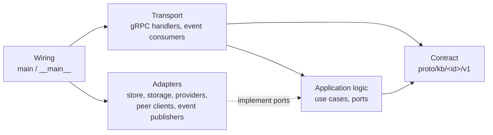

# Module architecture

Every module in `modules/<id>/` follows this architecture, whatever its language. It builds on the folder layout from [ADR 0002](../adr/0002-module-per-folder-monorepo.md) and is decided in [ADR 0008](../adr/0008-reference-module-architecture.md). How the modules fit together is in the [overview](overview.md); code-level conventions are in the [coding standards](../coding-standards.md).

**Reference implementations:** `document` for Go (`modules/document/service`) and `llm` for Python (`modules/llm/service`). Start a new module by copying the structure of the matching one. Gaps between the existing modules and this document are tracked as issues; see [Known deviations](#known-deviations).

## Layers



| Layer | Responsibility | May depend on | Must not |
|---|---|---|---|
| **Contract** (`proto/`) | RPCs and event messages: the module's only public surface. | `kb.common.v1`, well-known types | Contain logic |
| **Transport** | Decode requests, validate input shape, call application logic, encode responses, map errors to gRPC status. Event consumers decode messages and call the same logic. | Contract, application | Talk to a database, bucket or peer directly |
| **Application** | Use cases: rules, orchestration across adapters, state transitions. Declares the **ports** (interfaces) it needs. | Contract types, its own ports, generated client interfaces of declared peers | Import gRPC status/codes, SQL, S3 or HTTP clients |
| **Adapters** | Implement ports: sqlc store, S3, LLM providers, publishers, other modules' clients. | Infrastructure libraries, `platform/` | Contain business rules |
| **Wiring** | Load config, set up logging, connect infrastructure, build adapters, register servers, run. | Everything in the module, `platform/` | Contain logic beyond construction |

**Collapsing transport and application** is allowed while every handler is validation plus a single adapter call (the `document` service today): the logic stays in the `server` package. As soon as a use case orchestrates two or more adapters, or is shared by a gRPC handler and an event consumer, it moves into the application package.

Errors cross layers as values, not as gRPC statuses: application code returns typed errors (Go: sentinel errors such as `app.ErrNotFound`, `errors.Is`; Python: exception classes in the application module), and transport maps them once.

## Layout

| | Go (`service/`) | Python (`service/` or `worker/`) |
|---|---|---|
| Wiring | `cmd/<module>-service/main.go`: `Config` struct, `run()`, `healthcheck` subcommand | `src/kb_<component>/__main__.py`: `run()` and `main()` |
| Config | `Config` in `main.go`, embedding `config.Base` (`platform/go/config`) | `config.py`: `Settings(PlatformSettings)` (`kb_platform.config`) |
| Transport | `internal/server` (gRPC), `internal/events` (consumers) | `server.py` (servicer); consumer loop in `__main__.py` for workers |
| Application | `internal/app` (or inside `internal/server` while collapsed) | `<use case>.py` modules, e.g. `chat.py`, `worker.py` (`Processor`) |
| Ports | Interfaces in the consuming package (`server.Repository`, `server.ObjectStore`) | `Protocol` classes in the consuming module, or a `ports.py` |
| Adapters | `internal/store` (sqlc + hand-written `repo.go`), `internal/storage`, `internal/events` (publisher) | `db.py` / `repository.py`, `providers/` with a `REGISTRY` |
| Migrations | `migrations/*.sql` (goose), embedded via `migrations.go` | `migrations/versions/*.py` (Alembic) |
| Tests | `*_test.go` next to the code, fakes embed the port interface | `tests/` per component, fakes implement the `Protocol` |

A module with a Go service and a Python worker (ingestion) applies both columns, one per component. Generated code (`api/`, sqlc `internal/store/*.go` except `repo.go`) is an adapter detail and is never edited.

## Runtime conventions

- **Configuration:** `KB_*` environment variables only, read through the platform config helpers. Every setting has a default that works for local development (`localhost` addresses); compose overrides them. Peer addresses are `KB_<MODULE>_ADDR`. Settings that must match another module (e.g. `KB_EMBEDDING_DIMENSIONS`) are documented on both sides.
- **Logging:** `platform/go/logging` (`slog`) and `kb_platform.logging`; JSON by default, the `service` field set to the component name. Log errors once, where they are handled.
- **Health:** every gRPC server exposes the standard `grpc.health.v1` service via `platform/go/grpcserver` or `kb_platform.grpc.serve`, and a `healthcheck` entry point used by compose (`/app healthcheck`, `python -m kb_platform.healthcheck <port>`). A service reports `SERVING` once **its own** infrastructure (database, bucket, stream) is ready and `NOT_SERVING` while shutting down. Peer modules never affect its health. Workers have no gRPC port and no health endpoint; compose restarts them when they exit.
- **gRPC status mapping** (done once, in transport):

  | Situation | Status |
  |---|---|
  | Malformed or missing input | `INVALID_ARGUMENT` |
  | Unknown id (including malformed ids, where it doesn't leak information) | `NOT_FOUND` |
  | Valid request in the wrong state ("upload already completed") | `FAILED_PRECONDITION` |
  | A peer module or the module's own infrastructure is unreachable | `UNAVAILABLE` |
  | Overload, limits reached | `RESOURCE_EXHAUSTED` |
  | Anything else | `INTERNAL` with a generic message (`"<op> failed"`); the cause is logged |

  A peer's status is never passed through unchanged: a peer's `NOT_FOUND` means something different from this module's `NOT_FOUND`. Map peer `UNAVAILABLE` / `DEADLINE_EXCEEDED` to `UNAVAILABLE`, and everything else to `INTERNAL`, unless the use case defines a better mapping.

  A streaming RPC that has already sent results may instead end with an error event in its stream, using the same codes and a readable message, so the results so far are kept (`ChatService.StreamChat`).

## Talking to other modules

- Only through the peer's **generated gRPC client** (`modules/<peer>/api/{go,python,ts}`) or by **consuming its events** (stream owned by the peer, messages from its proto package). Never its database schema, bucket, stream configuration or internal packages.
- Peers are **soft dependencies**. A module starts, migrates and reports healthy without them. Clients are created lazily (`grpc.NewClient`, `grpc.aio.insecure_channel` don't connect at construction) and calls that need an unavailable peer fail with `UNAVAILABLE`. RPCs that don't need the peer keep working. Compose files declare `depends_on` only for infrastructure, never for other modules' services.
- Event consumers are idempotent (at-least-once delivery, [ADR 0004](../adr/0004-nats-jetstream-events-between-modules.md)) and treat a peer outage as a transient error: they NAK and retry rather than fail the work permanently.
- Publishing an event that another module consumes makes it part of the contract; it follows the same compatibility rules as RPCs (`buf breaking`).

## Browser-reachable RPCs

Envoy routes the browser to a service's methods one by one (`deploy/envoy/envoy.yaml`, generated from the manifests). Every method of a service in `grpc_services` is public unless the manifest marks it `internal`:

```yaml
services:
  - name: document-service
    grpc_services: [kb.document.v1.DocumentService]
    internal:                                        # called by other modules' services only
      - kb.document.v1.DocumentService/AddChunks     # one method
      # - kb.document.v1.DocumentAdminService        # or a whole service from grpc_services
```

- Mark a method `internal` when only backend code calls it: writes that belong to a pipeline (`AddChunks`, `SetDocumentStatus`), raw access (`ReadContent`), or anything that would let a browser spend provider resources directly (`LlmService/Generate`, `Embed`). A new RPC is public by default, so decide when adding it.
- Envoy has no route for an internal method; the browser gets HTTP 404, which gRPC-Web clients report as `UNIMPLEMENTED`. Services call each other directly (`KB_<MODULE>_ADDR`), not through Envoy, so internal methods keep working between modules.
- `tools/modgen` reads the method names from the module's `.proto` files and fails when a `grpc_services` entry or an `internal` entry names nothing that exists.
- Every routed call is authenticated by Envoy ([ADR 0009](../adr/0009-oidc-authentication-at-the-gateway.md)). A handler gets the calling user with `grpcserver.UserFromContext(ctx)` (Go) or `kb_platform.grpc.current_user()` (Python). Clients opened with `grpcserver.Dial` / `kb_platform.grpc.channel` pass that user on as `x-kb-user`, so a service calling a peer while handling a user's request acts for the same user; calls made outside a user's request (workers, event consumers) carry no user. User-facing RPCs reject a call without a user with `UNAUTHENTICATED` and report another user's resources as `NOT_FOUND`; pipeline RPCs called without a user act on any resource. Tests set a user with `grpcserver.WithUser` / `kb_platform.grpc.as_user`.

## Deployment settings

The Helm chart ([Kubernetes](../operations/kubernetes.md)) is generated from the manifests too. Two fields per service tell it what compose files spell out by hand:

```yaml
services:
  - name: document-service
    infra: [postgres, s3]        # shared infrastructure it connects to: postgres, nats, s3
    env:                         # KB_* settings a deployment sets, with defaults
      KB_MAX_UPLOAD_BYTES: "52428800"
```

- `infra` gives the component the chart's connection settings: `KB_DATABASE_URL` (in the Go or SQLAlchemy form), `KB_NATS_URL`, `KB_S3_*`. List exactly what the component's compose service has in `depends_on`.
- `env` becomes the default of `components.<name>.env` in the chart's values. Only list settings whose code default (meant for local development) is wrong in a cluster, or that operators should see; everything else keeps its default.
- Peer addresses (`KB_<MODULE>_ADDR`) need no field: they follow from `depends_on`.

## Declared dependencies

`module.yaml` lists what a module uses from other modules:

```yaml
depends_on: [document, llm]       # modules whose contract (RPCs or events) this module uses
consumes:                         # event subjects this module subscribes to
  - kb.ingestion.uploaded
```

- `depends_on` names modules, not services. A module may import another module's `api/` package only if it is listed. The graph must be acyclic: if two modules need each other, one of them talks through events.
- `consumes` lists every subject the module subscribes to (its own included). Each subject must belong to the module itself or to a module in `depends_on`.
- `tools/modgen` (`task gen`) validates both fields (unknown or duplicate modules, cycles, subjects of undeclared modules) and generates the import-boundary rules from them.

### Enforcement

`task lint` fails when a module imports anything but its own code, `platform/` and the `api/` of a module in its `depends_on`, or when `platform/` imports a module:

| Language | Tool | Generated config |
|---|---|---|
| Go | golangci-lint `depguard` | `.golangci.yml` (from `tools/modgen/templates/golangci.yml.tmpl`) |
| Python | `lint-imports` (import-linter) | `.importlinter` |
| TypeScript | biome `noRestrictedImports` overrides | `biome.modules.jsonc`, extended by `biome.json` |

Relative TypeScript imports may go up at most two levels, so they stay inside the package. `task test:boundaries` (part of `task test`) checks that each tool rejects the violations in `tools/modgen/testdata/boundaries` and nothing else.

## UI package

- `modules/<id>/ui` is the npm package `@kb/module-<id>`, named in `module.yaml` under `ui`. `src/index.tsx` default-exports `defineModule({ id, title, icon, routes, nav?, feature?, widgets?, search? })` from `@kb/module-sdk`; `id` matches the manifest. The shell mounts the routes under `/m/<id>` and lists the nav items.
- The home page is built from the modules: `feature` is the module's tile in the showcase (a benefit-led `headline`, a one-sentence `description`, a `cta` into the module); a module that sets `prompt` (a route that reads `?q=`, plus the input's label, placeholder and button text) owns the hero's main input, which chat uses to start a conversation with the question (`/m/chat/new?q=…`); the first two other features become the hero's buttons. Any `widgets` render below the showcase, outside the module's routes (so their links are absolute, `/m/<id>/…`), each in its own error boundary.
- `search` is the module's group in the global search (the field at the top of the sidebar, ⌘K / Ctrl+K, and `/search?q=`): a `label` plus `search(query, signal, context)` returning hits (`title`, optional plain-text `snippet`, absolute `href`), best first and capped (around 20). The shell runs every provider in parallel after typing pauses, aborts `signal` when the query changes, shows five hits per group in the popup and all of them on the search page, and turns a rejection into an error in that group only (`UNAVAILABLE` reads "<label> isn't available right now."). `context.client(Service)` gives a typed client, since the function runs outside React; pass `{ signal }` to the RPC. The shell adds its own "Pages" group from the `nav` items.
- Module UIs load lazily ([#60](https://github.com/ChristophBe/kb/issues/60)). `src/manifest.ts`, exported as `@kb/module-<id>/manifest`, default-exports `defineManifest({ id, title, icon, nav?, feature?, widgets?, search? })`: everything the shell needs before the module's code loads, so the sidebar, the home page and the global search work from the initial bundle. `index.tsx` spreads it and adds the `routes`; `modules.gen.ts` imports every manifest eagerly and the package itself with `import()`, so a module's pages load as their own chunk on the first visit to `/m/<id>` (while loading, the shell shows a skeleton; if the chunk can't be fetched, typically after a deploy, it offers **Reload page**). Keep page code out of the manifest: `widgets` are `lazy(() => import("./Widget.tsx").then(…))` components, and `search` is `lazySearch(label, () => import("./search.ts").then((m) => m.search))`, which loads only the search function on the first query, so every enabled module's group still answers the first search. A disabled module's code is never fetched.
- One file per page component (`DocumentList.tsx`, `DocumentDetail.tsx`); small helpers in camelCase files (`status.ts`).
- Data access: `useClient(<Service>)` with `useQuery` / `useMutation` from `@kb/module-sdk`, using the module's own `@kb/<id>-api` package or a declared peer's. No hand-rolled `fetch`, no transport setup.
- Components and styling come from `@kb/ui` and the design tokens ([UX standards](../ux-standards.md)). A module UI never imports another module's UI package; cross-module links are plain routes (`/m/document/<id>`).

## Known deviations

Gaps between the existing modules and this document, each tracked as an issue under the module's epic:

| Module | Gap | Issue |
|---|---|---|
| chat | None found | — |
| document | None found | — |
