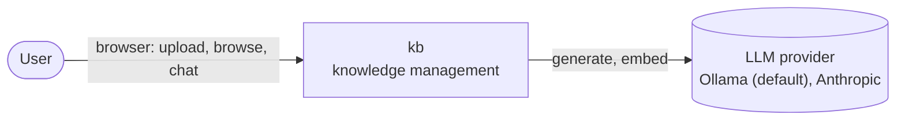
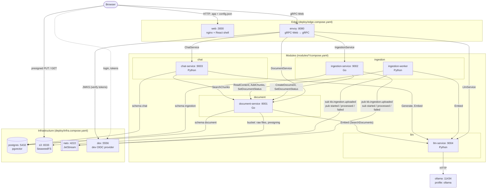
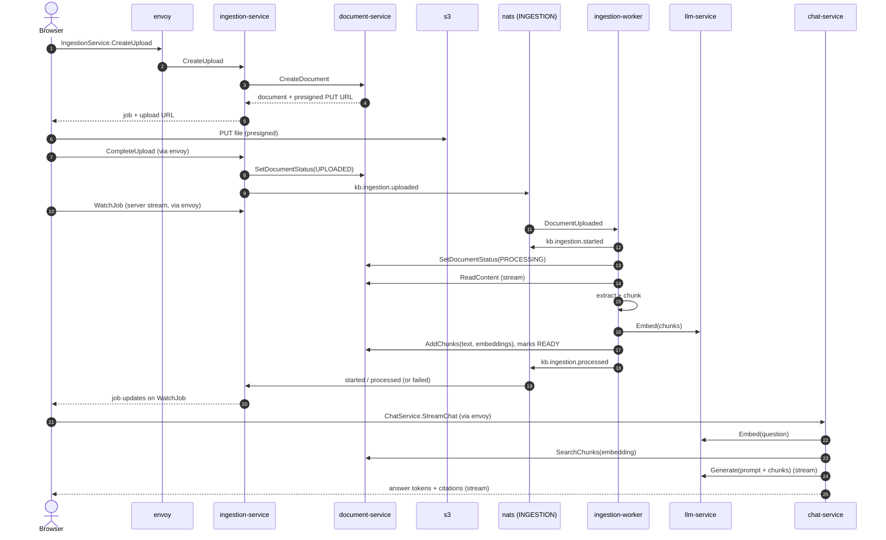

# Architecture overview

How the modules, the infrastructure and the browser fit together. The diagrams follow `compose.yaml` (and the fragments it includes) and the module manifests in `modules/*/module.yaml`; update them when either changes. The reasons behind the structure are recorded as [ADRs](../adr/README.md); the inside of a module is described in [module.md](module.md).

## System context

A user works with kb only through the browser. kb's only external dependency is an LLM provider, reached exclusively through the `llm` module ([ADR 0005](../adr/0005-llm-module-is-the-only-vendor-gateway.md)).

## Containers

| Container | Module | Owns | Calls (gRPC) | Events (stream `INGESTION`) |
|---|---|---|---|---|
| `document-service` | document | schema `document` (documents, chunks + `vector(768)`), S3 bucket | llm (only `SearchDocuments`) | — |
| `ingestion-service` | ingestion | schema `ingestion` (jobs), stream `INGESTION` | document | publishes `uploaded`; consumes `started`, `processed`, `failed` |
| `ingestion-worker` | ingestion | — | document, llm | consumes `uploaded`; publishes `started`, `processed`, `failed` |
| `chat-service` | chat | schema `chat` (conversations, messages) | document, llm | — |
| `llm-service` | llm | provider registry | Ollama over HTTP, Anthropic API | — |
| `envoy` | — | per-method routes for the public RPCs of each manifest's `grpc_services` (not `internal`); token check, sets `x-kb-user` ([ADR 0009](../adr/0009-oidc-authentication-at-the-gateway.md)) | all four services | — |
| `web` | — | UI shell; module UIs from `apps/web/src/modules.gen.ts` | via envoy | — |

Modules never share a schema, bucket or stream: each is owned by one module, and other modules go through its gRPC API or its events ([ADR 0002](../adr/0002-module-per-folder-monorepo.md), [ADR 0004](../adr/0004-nats-jetstream-events-between-modules.md)).

## Upload → process → chat

On a processing error the worker sets the document to `FAILED` and publishes `kb.ingestion.failed` instead; the ingestion service marks the job failed. JetStream redelivers an unacknowledged `uploaded` event up to three times.
