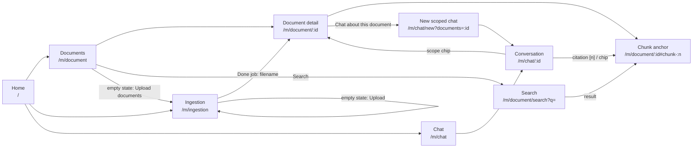

# M1 UI/UX draft

Low-fidelity wireframes and flows for every UI area M1 adds or reworks. The M1 issues implement against these drafts; deviations are discussed on the issue and then reflected here. Everything follows the [UX and accessibility standards](../../ux-standards.md): tokens, APG patterns, loading/empty/error/success states, WCAG 2.2 AA.

| Area | Draft | Issues |
|---|---|---|
| Shell: error boundary, toasts, loading states | [shell.md](shell.md) | #58 |
| Documents: list, detail with chunks, metadata editing, search | [documents.md](documents.md) | #21, #22, #23 |
| Ingestion: upload progress, per-file errors, retry | [ingestion.md](ingestion.md) | #34, #69 |
| Chat: Markdown + citations, stop, document scope, rename, stream errors | [chat.md](chat.md) | #41, #42, #44, #45, #46 |

## Clickable prototype

Every screen in this draft can be tried in the running app: start the web shell (`task web`, or `task up` for the whole stack) and open **Preview → M1 prototype** in the sidebar (`/prototype`). It needs no backend, uses mock data, and keeps changes until you reload.

- **Simulate** switches every screen between normal, loading, empty, error and service-unavailable states.
- Filenames and questions steer failures: an upload named `*fail*` breaks mid-upload, `*scan*` fails processing, other formats than PDF/Markdown/text are rejected; a chat question containing "fail" interrupts the answer.
- The code lives in `apps/web/src/prototype/` and is loaded only when opened. It is a design artefact: M1 issues implement the real screens in the module UIs, and its dialog, tabs, menu and toast components are candidates for `@kb/ui` (#58). `apps/web/src/prototype/prototype.test.tsx` renders every screen with axe and drives the main flows.

**How to read the wireframes:** boxes are regions, not pixel layouts. `[Button]` is a button, `[_____]` an input, `( )`/`(•)` radio, `[x]` checkbox, `▾` a menu button, `…` truncated text, `░░░` a skeleton. Every wireframe is the `md` (≥ 768 px) layout unless marked *narrow* (< 640 px). Copy in wireframes is the proposed microcopy.

## Navigation map

- **Entry points:** the shell sidebar lists each module's nav items (Documents, Search, Ingestion, Chat, Models). Home leads with a hero (search box and the main actions), then the user's recent conversations and documents, then one feature tile per module.
- **Chat → documents:** every citation links to `/m/document/:id#chunk-:index`, which scrolls to and focuses the chunk in the detail page's chunk list (#21, #41). Scope chips in the conversation header link to the document.
- **Documents → chat:** the detail page has "Chat about this document", which opens `/m/chat/new?documents=:id`. The chat module creates a scoped conversation and redirects to it (#44 follow-up).
- **Ingestion → documents:** a finished job's filename links to its document.
- **Back navigation** is the browser's: every view has its own URL, and dialogs don't change it.
- Cross-module links are plain routes; a module UI never imports another module's UI ([module architecture](../../architecture/module.md#ui-package)).

## Shared conventions in these drafts

- **Page structure:** `<main>` with one `<h1>` from `PageHeader`, then `<h2>` per section. Focus moves to the `<h1>` after route changes (shell, #58), and the document title becomes `<Page> · Knowledge Base`.
- **Live regions:** one polite `role="status"` region and one `role="alert"` region, both owned by the shell's toast host (#58). Module UIs announce through the toast API or a component-local `role="status"`, never by adding their own global regions.
- **Destructive actions:** a confirmation dialog naming the item (delete document, delete conversation). Deleting a single upload row that hasn't been submitted needs no confirmation.
- **Loading:** a skeleton for lists and detail pages, a spinner with a label for actions; both delayed by 300 ms.

## Review and sign-off

Reviewed on the PR that adds this draft. Sign-off is recorded as a comment on #74; open questions are listed at the end of each area file.
