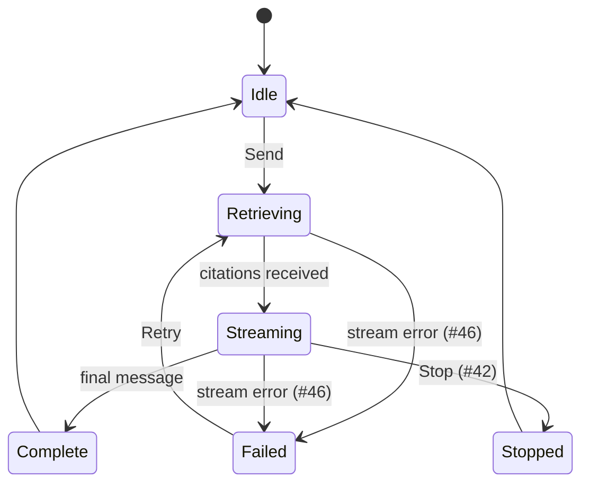

# Chat: Markdown answers, citations, stop, scope, rename, stream errors (#41, #42, #44, #45, #46)

## Flow



## Layout (`/m/chat/:id`)

```
┌────────────────────┬───────────────────────────────────────────────────┐
│ Conversations      │ Q3 revenue questions   [Rename]                 ▾ │
│ [+ New chat]       │ Scope: Quarterly report.pdf ✕ · Board minutes ✕   │
│                    │        [+ Add documents]                          │
│ ▸ Q3 revenue que…🗑│───────────────────────────────────────────────────│
│   Onboarding     🗑│                    ┌──────────────────────────────┐│
│   New conversation🗑│                    │ How did revenue develop?    ││
│                    │                    └──────────────────────────────┘│
│                    │ ┌───────────────────────────────────────────────┐ │
│                    │ │ Revenue grew by **12 %** in Q3 [1], mainly …  │ │
│                    │ │ - Product A: +8 % [2]                          │ │
│                    │ │ Sources: [1 Quarterly report.pdf] [2 Board…]  │ │
│                    │ └───────────────────────────────────────────────┘ │
│                    │───────────────────────────────────────────────────│
│                    │ [Ask a question…                               ]  │
│                    │ [x] Use knowledge base          [■ Stop] [Send]   │
└────────────────────┴───────────────────────────────────────────────────┘
```

*Narrow:* the conversation list is its own view (`/m/chat`); a conversation shows `← Conversations` in its header. The composer sticks to the bottom; the message list scrolls above it with `scroll-padding` so focused content isn't hidden.

## Conversation list and rename (#45)

- Each row: link with the title, plus a delete button ("Delete conversation Q3 revenue questions") that is visible on hover and focus. Delete asks for confirmation ("Delete "Q3 revenue questions"? Its messages are removed.") and then moves focus to the next conversation, or to `[+ New chat]`.
- **Rename** from the conversation header: `[Rename]` turns the title into an input:

```
[Q3 revenue questions_______________]  [Save] [Cancel]
⚠ Title must not be empty
```

  `Enter` saves, `Esc` cancels, and focus returns to `[Rename]`; the list updates and a status says "Conversation renamed". Empty → `INVALID_ARGUMENT` shown under the field.
- **Empty list:** "No conversations yet." + `[+ New chat]`.

## Document scope (#44)

- The header shows the scope as chips, each linking to its document with a remove button ("Remove Quarterly report.pdf from scope"). No chips means "Scope: all documents".
- `[+ Add documents]` opens a dialog with a combobox (APG pattern) searching document titles, and a checklist of the selected ones:

```
┌ Choose documents for this chat ──────────────────────────────┐
│ [Search documents… ▾]                                        │
│  [x] Quarterly report.pdf                                    │
│  [x] Board minutes.md                                        │
│  [ ] Onboarding notes.md                                     │
│ Leave empty to use all documents.     [Cancel]  [Apply]      │
└──────────────────────────────────────────────────────────────┘
```

- Opened from a document ("Chat about this document"), a new conversation starts with that document in scope; the composer has focus.
- Changing the scope affects only following questions; a status line in the message list notes "Scope changed to 2 documents".

## Answers: Markdown and citations (#41)

- Answers render sanitised Markdown (headings, lists, code blocks with a `[Copy code]` button, tables). Raw HTML is never rendered.
- Inline markers `[1]` are links to `/m/document/:id#chunk-:index` with the accessible name "Source 1: Quarterly report.pdf, chunk 3". The "Sources" row below the answer repeats them as chips with the document title.
- The user's own messages are plain text (no Markdown), in the accent style, aligned right.

## Streaming, stop and errors (#42, #46)

```
│ ┌───────────────────────────────────────────────┐ │
│ │ Revenue grew by 12 % in Q3 [1], mainly driven▍│ │   ← streaming (aria-busy)
│ └───────────────────────────────────────────────┘ │
│ [Ask a question…                               ]  │
│ [x] Use knowledge base          [■ Stop] [Send]   │   ← Send disabled, Stop shown
```

```
│ ┌───────────────────────────────────────────────┐ │
│ │ Revenue grew by 12 % in Q3 [1], mainly …      │ │
│ │ ◼ Stopped                                     │ │   ← partial answer kept (#42)
│ └───────────────────────────────────────────────┘ │
```

```
│ ┌───────────────────────────────────────────────┐ │
│ │ Revenue grew by 12 % …                        │ │
│ │ ⚠ The answer was interrupted: the Models      │ │   ← failed (#46)
│ │   service isn't available. [Retry]            │ │
│ └───────────────────────────────────────────────┘ │
```

- While retrieving: a placeholder message with "Searching documents…" and a spinner.
- While streaming: `Send` is disabled (with the reason in its `aria-describedby`: "Wait for the answer or stop it"), and `[■ Stop]` appears next to it. `Esc` in the composer also stops.
- **Stopped** answers stay with a "Stopped" label and are persisted (#42). **Failed** answers keep the partial text, a readable reason (no raw status code) and `[Retry]`, which resends the same question (#46).
- **Empty conversation:** "Ask a question about your documents." with two example prompts as buttons that fill the composer.

## Keyboard and focus

1. Focus stays in the composer after sending, so follow-up questions need no extra keystroke.
2. `Enter` sends, `Shift+Enter` adds a line break; `Esc` stops a running answer.
3. `[■ Stop]` is reachable by `Tab` from the composer while streaming; after stopping, focus returns to the composer.
4. Tab order: conversation header (Rename, scope chips) → messages (citation links and Copy code buttons, oldest first) → composer → Stop / Send. `Shift+Tab` from the composer reaches the newest answer's links.
5. Opening a conversation focuses the composer; the list scrolls to the newest message only if the user hasn't scrolled up.

## Screen-reader announcements

- The message list is `role="log"` with `aria-live="off"`, so tokens aren't read one by one. The answer being streamed has `aria-busy="true"`.
- One polite status per answer: "Answer ready" when complete, "Answer stopped" when stopped; an alert for "The answer was interrupted: …".
- "Searching documents…" is announced once when retrieval starts (polite).
- Rename, delete and scope changes announce through the shell toast/status (#58).

## Open questions

- Should the "Use knowledge base" toggle stay once document scope exists? Proposed: keep it; off = plain model chat.
- Is `Esc` to stop discoverable enough? Proposed: mention it in the Stop button's tooltip and description.
