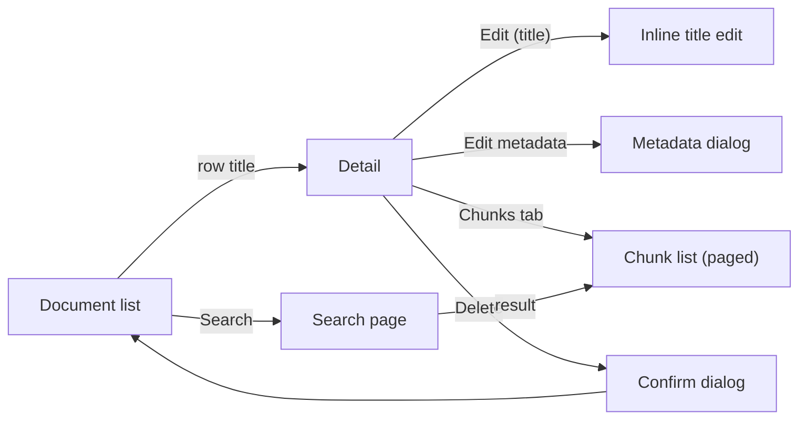

# Documents: list, detail, chunks, metadata, search (#21, #22, #23)

## Flow



## Document list (`/m/document`)

```
Documents                                   [Search]  [Upload documents]
All documents in the knowledge base.
┌──────────────────────────────────────────────────────────────────────┐
│ Title                       Status       Size      Added        ▾    │
├──────────────────────────────────────────────────────────────────────┤
│ Quarterly report.pdf        ● Ready      1.2 MB    2 min ago    ▾    │
│ ||||||||||||||| 42 chunks, 2 cited                                   │
│ Onboarding notes.md         ● Processing 14 KB     5 min ago    ▾    │
│ broken-scan.pdf             ● Failed     3.4 MB    1 h ago      ▾    │
└──────────────────────────────────────────────────────────────────────┘
```

- `▾` per row is a menu button ("Actions for Quarterly report.pdf"): Open, Chat about this document, Delete.
- The title is the row's link; the status is a `Badge` with text, never colour alone.
- A `ChunkStrip` under the title shows the document as a barcode: one tick per chunk, cited chunks taller and in ink, with the counts as text. The detail page shows it under the metadata line.
- **Empty:** "No documents yet. Upload documents to get started." + `[Upload documents]` (link to `/m/ingestion`).
- **Loading:** table skeleton (3 rows). **Error:** inline error with `[Try again]`.
- *Narrow:* rows become stacked cards: title, then "Ready · 1.2 MB · 2 min ago".

## Detail (`/m/document/:id`)

```
← Documents
Quarterly report.pdf  [Edit title]               [Chat about this document]  ▾
● Ready · 1.2 MB · application/pdf · added 28 Oct 2026

[ Details ] [ Chunks (42) ]                                   (tabs)
┌──────────────────────────────────────────────────────────────────────┐
│ Details                                                              │
│ Filename        quarterly-report-q3.pdf                              │
│ Status          ● Ready                                              │
│ Metadata        source: finance · year: 2026        [Edit metadata]  │
│ Download        [Download original]                                  │
└──────────────────────────────────────────────────────────────────────┘
```

`▾` (page actions): Download, Delete. Delete opens the confirmation dialog:

```
┌ Delete "Quarterly report.pdf"? ──────────────────────────────┐
│ The document, its 42 chunks and its citations in chats will  │
│ be removed. This can't be undone.                            │
│                                  [Cancel]  [Delete document] │
└──────────────────────────────────────────────────────────────┘
```

Focus starts on `[Cancel]`. After deletion: navigate to the list, toast "Document deleted", focus on the list's `<h1>`.

### Title editing (#22)

```
Quarterly report.pdf  [Edit title]
        ↓ (Edit title)
Title [Quarterly report Q3______________]  [Save] [Cancel]
      ⚠ Title must not be empty
```

- `Enter` saves, `Esc` cancels; focus returns to `[Edit title]` and a polite status says "Title saved".
- Validation on submit: empty or whitespace-only → message under the field, `aria-invalid`, focus stays in the field.

### Metadata editing (#22)

Opens a modal dialog, because the key/value list can be long:

```
┌ Edit metadata ───────────────────────────────────────────────┐
│ Key              Value                                       │
│ [source______]   [finance__________]   [Remove source]       │
│ [year________]   [2026_____________]   [Remove year]         │
│ [____________]   [_________________]                         │
│ ⚠ Key "year" is used twice                                   │
│ [+ Add field]                                                │
│                                         [Cancel]  [Save]     │
└──────────────────────────────────────────────────────────────┘
```

- Each row is a `<fieldset>` with a visually hidden legend ("Field 2"); inputs are labelled "Key"/"Value".
- Errors (empty key, duplicate key) are shown next to the row on Save; focus goes to the first invalid input.
- `[+ Add field]` appends a row and focuses its key input; `[Remove …]` moves focus to the next row's key (or "Add field").
- Saved → dialog closes, focus returns to `[Edit metadata]`, toast "Metadata saved".

### Chunks tab (#21)

```
[ Details ] [ Chunks (42) ]
┌──────────────────────────────────────────────────────────────────────┐
│ #1   page 1 · 812 characters                                         │
│      Revenue in Q3 grew by 12 % compared to the previous quarter …   │
│      [Show full chunk]                                               │
├──────────────────────────────────────────────────────────────────────┤
│ #2   page 1 · 640 characters                                         │
│      …                                                               │
└──────────────────────────────────────────────────────────────────────┘
Showing 1–20 of 42                                 [Previous]  [Next]
```

- Tabs follow the APG tabs pattern; the selected tab is in the URL (`?tab=chunks`), so links can open it.
- Each chunk is an `<article id="chunk-:index">` with heading "Chunk 1". Deep link `#chunk-7` selects the Chunks tab, loads the page containing chunk 7, scrolls to it, highlights it briefly (respecting reduced motion) and focuses its heading.
- Pagination buttons announce "Showing 21–40 of 42" in a polite status and move focus to the first chunk heading of the new page.
- **Empty:** "This document has no chunks yet. They appear once processing has finished." **Processing:** same text plus the status badge. **Failed:** "Processing failed: <reason>" + link "Retry in Ingestion".

## Search (`/m/document/search?q=`) (#23)

```
Search
Find passages across all documents.
[ Search documents________________________ ]  [Search]

3 results for "revenue growth"                      (polite status)
┌──────────────────────────────────────────────────────────────────────┐
│ Quarterly report.pdf · chunk 1                              0.82     │
│ Revenue in Q3 grew by 12 % compared to the previous quarter …        │
├──────────────────────────────────────────────────────────────────────┤
│ Board minutes.md · chunk 4                                  0.71     │
│ … the growth in revenue was mainly driven by …                       │
└──────────────────────────────────────────────────────────────────────┘
```

- A `<form role="search">` with a labelled input; the query is in the URL, so results are linkable and Back works.
- Each result is a link to `/m/document/:id#chunk-:index`; the heading is "Document title, chunk n". The score is shown as text with the label "relevance".
- Submit with an empty query: "Enter a search term" under the field (also rejected server-side).
- **Loading:** result skeleton + the status "Searching…". **Empty:** "No passages match "…". Try other words." **Error:** inline error; `UNAVAILABLE` from llm → "Search needs the Models service, which isn't available right now."

## Keyboard and screen-reader notes

| Action | Keys | Focus after | Announcement |
|---|---|---|---|
| Open document | `Enter` on title link | Detail `<h1>` | Page title |
| Row actions | `Enter`/`Space` on `▾`, arrows, `Esc` | Menu items; back to `▾` | — |
| Save title | `Enter` | `[Edit title]` | "Title saved" (status) |
| Delete | Menu → dialog → `[Delete document]` | List `<h1>` | "Document deleted" (toast) |
| Switch tab | Arrows in tablist | Tab, then `Tab` into panel | Tab name and selection |
| Page chunks | `[Next]` | First chunk heading | "Showing 21–40 of 42" |
| Search | `Enter` in field | Stays in field | "3 results for …" |

## Open questions

- Should search live inside the Documents module (current proposal, #23) or become the global command palette later (#62)? Proposed: page now, palette reuses the RPC in M3.
- Should metadata editing be inline instead of a dialog? Proposed: dialog, since the field list is unbounded.
