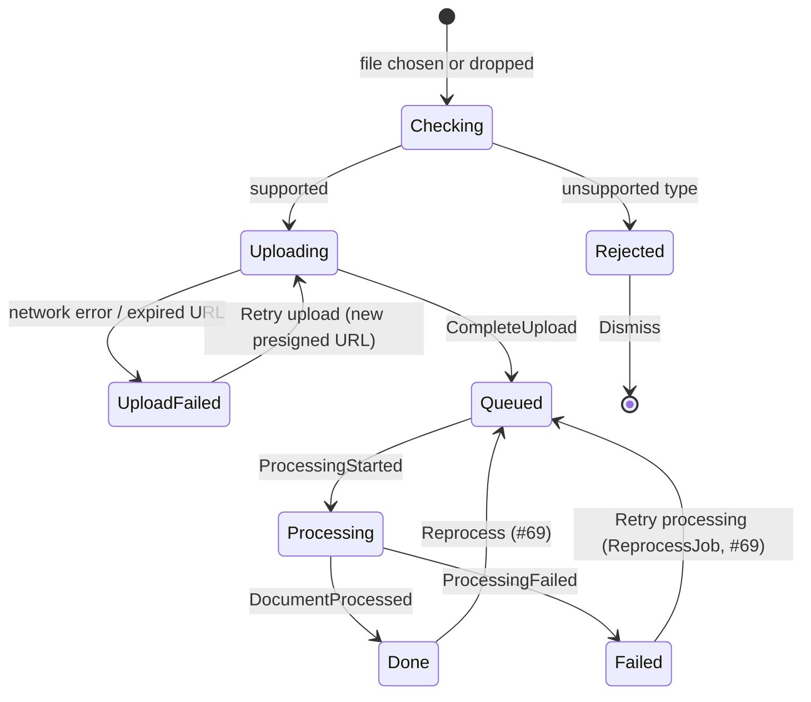

# Ingestion: upload with progress, per-file errors and retry (#34, #69)

## Flow



Two kinds of failure are kept apart in the UI: **upload failed** (the browser couldn't send the file; retried client-side, #34) and **processing failed** (the worker couldn't process it; retried server-side, #69).

## Upload page (`/m/ingestion`)

```
Ingestion
Upload documents to add them to the knowledge base.
┌ - - - - - - - - - - - - - - - - - - - - - - - - - - - - - - - - - - ┐
╎            ⇪  Drop files here or  [Choose files]                    ╎
╎               PDF, Markdown or plain text                           ╎
└ - - - - - - - - - - - - - - - - - - - - - - - - - - - - - - - - - - ┘

Uploads
┌──────────────────────────────────────────────────────────────────────┐
│ notes.md               ▓▓▓▓▓▓▓▓▓▓░░░░░░░░ 54 %       Uploading   [✕] │
│ report.pdf             ● Processing                  2 min ago       │
│ scan.pdf               ● Failed: no text found   [Retry processing]  │
│ slides.pptx            ⚠ Not supported (PDF, Markdown, text)    [✕]  │
│ big.pdf          ⚠ Upload failed: connection lost  [Retry upload] [✕] │
│ handbook.pdf           ● Done · 128 chunks           1 h ago         │
└──────────────────────────────────────────────────────────────────────┘
```

- **Drop zone:** a real `<button>Choose files</button>` opens the hidden-but-focusable file input; drag and drop is a pointer shortcut. While dragging, the zone shows "Drop to upload".
- **Rows** are a list (`<ul>`): filename, then state-specific content:
  - *Uploading:* a `<progress>` labelled "Uploading notes.md", with the value as text; `[✕]` cancels ("Cancel upload of notes.md").
  - *Rejected:* checked client-side before any request (#34); stays until dismissed.
  - *Upload failed:* `[Retry upload]` reuses the selected `File` and requests a new presigned URL.
  - *Processing failed:* the reason from `ProcessingFailed`, then `[Retry processing]` (#69).
  - *Done:* the filename links to the document (`/m/document/:id`); the row menu offers "Reprocess" (#69).
- **Empty:** "No uploads yet. Drop files above to add documents." **Loading:** list skeleton. **Error** loading jobs: inline error with `[Try again]`; the drop zone keeps working.
- *Narrow:* each row stacks filename / status / actions on separate lines; the drop zone shrinks to the `[Choose files]` button plus hint text.

## Keyboard and focus

1. `Tab` reaches `[Choose files]` first; `Enter`/`Space` opens the system file dialog.
2. After choosing files, focus stays on `[Choose files]`; new rows are added at the top.
3. `[Retry upload]` / `[Retry processing]` keep focus on the same row: the button is replaced by the row's progress, and focus moves to the row's `[✕]` or, if there is none, to the filename.
4. `[✕]` removes a row and moves focus to the next row's first control, or back to `[Choose files]`.

## Screen-reader announcements

Progress is **not** announced continuously. A polite status region local to the upload list announces state changes once per file:

| Event | Announcement |
|---|---|
| Files chosen | "Uploading 3 files" |
| Rejected | "slides.pptx isn't supported. Use PDF, Markdown or text." |
| Upload done → queued | "notes.md uploaded, processing" |
| Done | "notes.md is ready" |
| Upload / processing failed | "Upload of big.pdf failed" / "Processing scan.pdf failed: no text found" (alert) |

Finished uploads also show a toast only when the user has navigated away from the page (shell toast, #58).

## Open questions

- Should several files upload in parallel or one after another? Proposed: up to 3 in parallel, the rest show "Waiting".
- Client-side size limit: none until #24 adds a server-side one.
